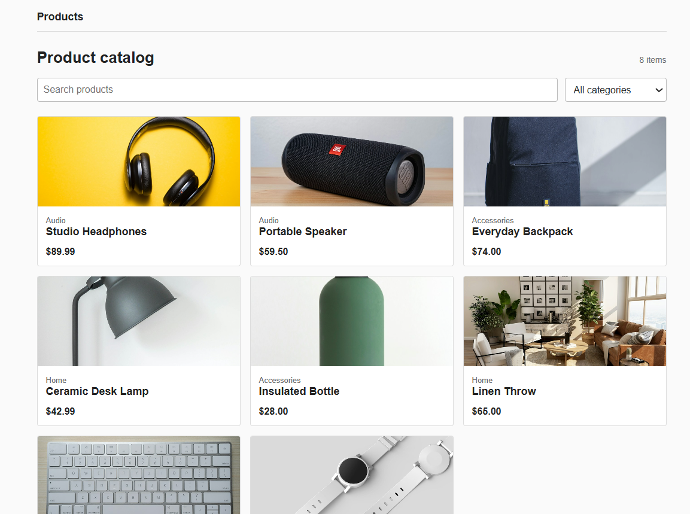
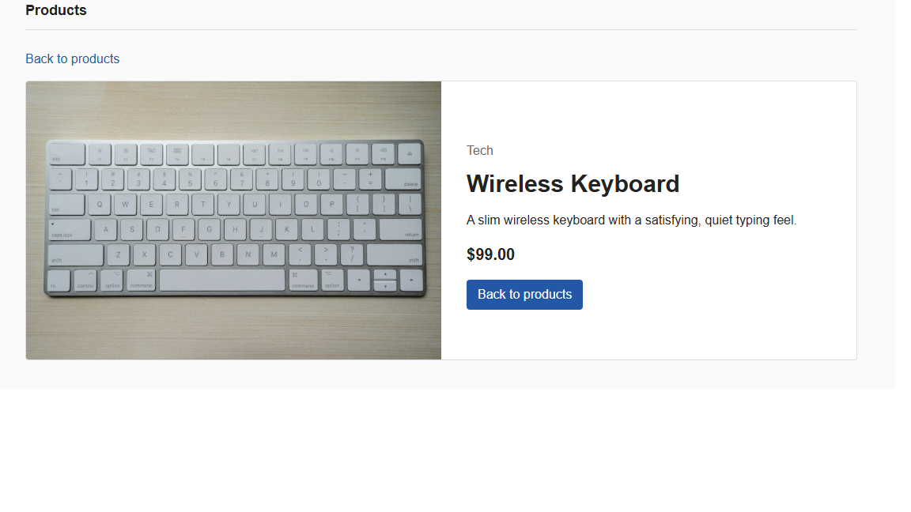
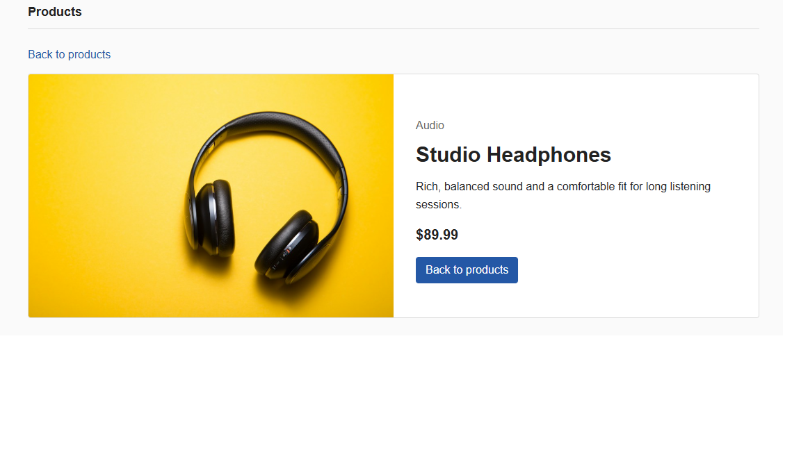
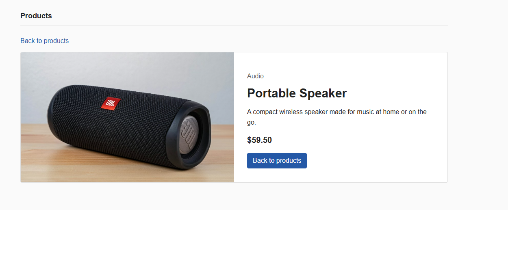

# Product Explorer
Typescript App

## Getting started

Requirements: Node.js and npm.

```bash
npm install
npm start
```

The app runs at [http://localhost:3000](http://localhost:3000).

## Available scripts

- `npm start` — start the development server.
- `npm run build` — create an optimized production build in `build/`.
- `npm test` — run the Create React App test runner.

## Project structure

- `src/data/products.ts` — sample product catalog data.
- `src/pages/ProductList.tsx` — searchable and filterable catalog.
- `src/pages/ProductDetails.tsx` — product detail view.
- `src/components/ProductCard.tsx` — product card component.

Product data is stored locally in the app; no API keys or environment variables are required.

Screenshots
   
